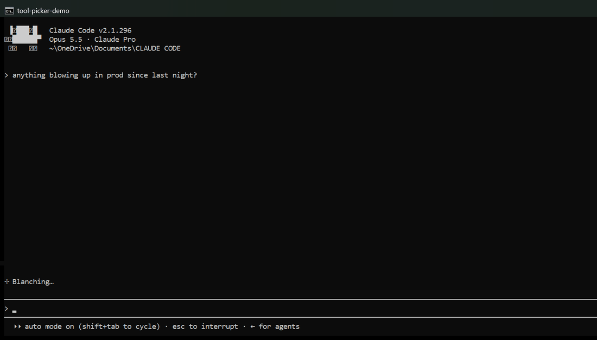

# tool-picker

A Claude Code plugin that shows you which of your installed skills, connectors and plugins fit your request, before Claude starts working.



*A real session for the prompt "anything blowing up in prod since last night?", sped up, with the empty middle of the window trimmed.*

Claude already chooses tools by itself, but it does so silently. If you have dozens of skills and connectors installed, you rarely find out which ones it considered or skipped. tool-picker makes that choice visible: on the first prompt of each session you get up to four picks, each with a one-line reason, and you tick the ones you want used.

It only recommends what you already have. It never suggests installing anything.

## Install

Requires [Claude Code](https://claude.com/claude-code) and Node.js on your PATH.

```
/plugin marketplace add Shrey-Parikh31/tool-picker
/plugin install tool-picker@tool-picker
```

Start a new session and type a real task, for example `review my code`.

## How it works

One `UserPromptSubmit` hook, [hooks/first-prompt.js](hooks/first-prompt.js), about 160 lines with no dependencies:

1. **Check.** On the first prompt of a session it looks through your skill folders for drifted duplicates (below) and reads your mute list.
2. **Hand over.** It adds a short instruction to Claude's context, about 350 tokens: match the prompt against the skills, plugins and connectors Claude can already see, using a few ranking rules (exact fit first, a purpose-built tool over a catch-all, working over needs-sign-in, no duplicates).
3. **Ask.** Claude picks up to four and asks one multi-select question. It uses what you choose, then does the task.

If nothing fits, Claude says so in one line and carries on. Later prompts in the same session are left alone, and so are slash commands, since typing one means you already chose.

**Duplicate skills are flagged.** If a personal or project skill has the same name as another copy on disk (another personal, project or plugin skill) and the files differ, the picker names it with the paths of every copy, so you can see that the name alone doesn't tell you which one will run. Two plugins that happen to share a skill name are not flagged, since plugin skills are already told apart by their plugin prefix.

The matching is done by Claude, not by keyword rules, so it understands what you mean. The cost is about 350 tokens on the first prompt of each session, plus the question and your answer. An earlier version also listed every installed skill by name, which tripled that; removing the list made no difference to the accuracy test below.

## Limits

- **Claude Code only.** The claude.ai chat and mobile apps do not run hooks.
- **Duplicate checks only cover skill files on disk.** Copies stored inside an app's own files, such as the desktop app's runtime, are not seen.
- **Installing it mid-session triggers it once** on your next prompt there, because it has not seen that session before. Resumed sessions stay quiet.
- **Greetings are skipped by a short English word list** (`hi`, `thanks`, `ok` and similar), so the picker waits for your first real task.
- **Scripted runs (`claude -p`) are skipped,** since nobody is there to pick. This relies on an undocumented environment variable, so it may stop working in a future Claude Code release.
- **Node.js must be findable.** The hook also looks in `C:\Program Files\nodejs`, because Git Bash on Windows can hand hooks a shortened PATH. If Node is installed somewhere else and missing from PATH, the hook does nothing.

## Mute a suggestion

Tell Claude to stop suggesting something ("stop suggesting the wowerpoint skill") and it adds the name to `~/.claude/tool-picker-ignore.txt`. You can also edit that file yourself: one name per line, `#` for comments, matched without caring about case. A muted tool still works when you ask for it; it just stops appearing as a pick.

## Turn it off

Set the environment variable `TOOL_PICKER=off` before starting Claude Code. Unset it to turn the picker back on.

## Test

Runs on Linux, macOS and Windows on every push.

```
node test.js
```

## Accuracy test

[eval/cases.json](eval/cases.json) holds 70 prompts. 44 need a tool and list the tools that would be a correct pick; 26 need no tool at all, so the right answer is to suggest nothing. [eval/run.js](eval/run.js) sends each prompt to Claude with the hook's real instruction and scores the two groups separately, because a suggestion on a prompt that needs no tool is just friction.

```
node eval/run.js
```

Result on the author's machine (Claude Opus 5.5, about 130 skills and 12 connected connectors), from the current version. Two runs scored 4 and 5 false suggestions, so expect about one prompt of difference between runs:

| | Result |
|---|---|
| Needs a tool: top pick correct | 44 of 44 |
| Needs a tool: a correct pick in the top four | 44 of 44 |
| Needs no tool: stayed silent | 22 of 26 |
| False suggestions | 4 of 26 |

Three of the four false suggestions picked `claude-mem:what-the` for questions like "explain big O notation like I'm 12". That skill's description is "a plain-English breakdown of something technical", so those labels are arguably wrong rather than the picks; I left the labels as they were written before the run. The clear mistake was suggesting architecture skills for "do I even need a database for a todo app only I use?". Full output is in [eval/results.json](eval/results.json).

Many prompts are deliberately messy: lowercase, vague, no tool named ("ugh the login thing is broken again, worked fine yesterday"), or a trap that mentions a tool name but needs none ("what does the word 'sentry' mean in english").

Read the numbers with care: the test set is small and was not labelled independently, and a pick counts if it contains an expected name. Prompts written and labelled by other people would be a stronger test.

It runs against your own Claude Code setup and uses your Claude usage: 70 short sessions, a few minutes in total. The expected answers were written for one machine's installed tools, so edit `cases.json` to match yours before trusting the score.

## Uninstall

```
/plugin uninstall tool-picker@tool-picker
```

## License

MIT
